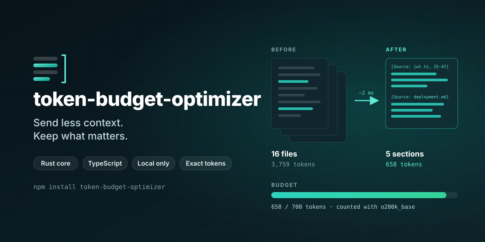
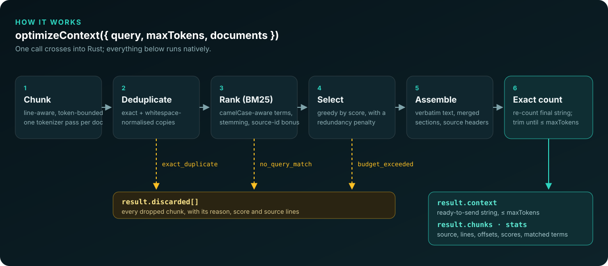
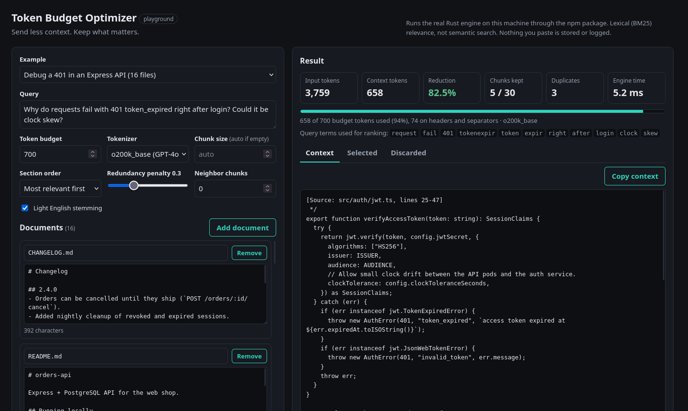

<p align="center">
  
</p>

<p align="center">
  <a href="https://www.npmjs.com/package/token-budget-optimizer"></a>
  <a href="https://github.com/Truta446/token-budget-optimizer/actions/workflows/ci.yml"></a>
  
  
  
  
  <a href="LICENSE"></a>
</p>

<p align="center">
  <a href="#quick-start">Quick start</a> ·
  <a href="#before-and-after">Before and after</a> ·
  <a href="#how-it-works">How it works</a> ·
  <a href="#playground">Playground</a> ·
  <a href="#performance">Performance</a> ·
  <a href="#quality">Quality</a> ·
  <a href="#api">API</a>
</p>

---

Give it a query, a token budget and your documents. You get back the most relevant parts as a ready-to-send context string that **never exceeds the budget**, plus the reason every chunk was kept or dropped. The engine is Rust, the API is TypeScript, and everything runs in your process: no API keys, no embeddings, no model calls, no network.

```ts
import { optimizeContext } from "token-budget-optimizer";

const result = await optimizeContext({
  query: "Why do requests fail with 401 token_expired right after login?",
  maxTokens: 700,
  documents: files.map((f) => ({ id: f.path, content: f.text })),
});

result.context;            // "[Source: src/auth/jwt.ts, lines 25-47]\n..."
result.stats;              // { originalTokens: 3759, optimizedTokens: 658, ... }
result.discarded[0].reason; // "exact_duplicate" (a vendored copy of jwt.ts)
```

## Why

RAG pipelines, code assistants and agents all hit the same step between "retrieve" and "generate": a pile of candidate text has to fit into a prompt. The usual answer is `text.slice(0, n)` or "the first five results", with characters standing in for tokens. That breaks in predictable ways:

- the important paragraph is the sixth result, so it gets **cut**
- two results are the same page, so the budget pays for it **twice**
- headers and separators were never counted, so the prompt **overflows**
- nothing records **what was dropped**, so you can't debug a bad answer

This library replaces that step with something deterministic, explainable and exact.

## Features

- **Hard budget.** The final string is counted with a real tokenizer (`o200k_base` or `cl100k_base`), headers and separators included. It never exceeds `maxTokens`.
- **Relevant first.** BM25 ranking with code-aware terms (`verifyToken` → `verify`, `token`), diacritic folding, light stemming and CJK bigrams.
- **No repeats.** Exact and whitespace-normalised duplicates are removed. Near-duplicates are penalised, never silently deleted.
- **Explainable.** Every chunk carries its source, line range, offsets, token count, score breakdown, matched terms and a reason.
- **Verbatim.** Text is copied from your documents unchanged. Nothing is summarised or rewritten.
- **Deterministic.** Same input, byte-identical output.
- **Fast.** About 2.6 M tokens/s end to end; async calls run on the libuv thread pool.
- **Typed.** Document `metadata` types flow through to every returned chunk.
- Zero runtime dependencies, prebuilt binaries for Linux, macOS and Windows, Node ≥ 22.12.

## Install

```sh
npm install token-budget-optimizer
# or: pnpm add token-budget-optimizer
```

The native binary for your platform is installed automatically. No Rust toolchain needed.

## Quick start

```ts
import { optimizeContext } from "token-budget-optimizer";

const result = await optimizeContext({
  query: "Why does the auth middleware return 401?",
  maxTokens: 120,
  documents: [
    { id: "auth.ts", content: authSource },
    { id: "middleware.ts", content: middlewareSource },
    { id: "database.ts", content: databaseSource },
  ],
});

console.log(result.context);
for (const chunk of result.discarded) console.log(`dropped ${chunk.id}: ${chunk.reason}`);
```

Real output ([`examples/basic`](examples/basic/index.ts)):

```text
[Source: middleware.ts, lines 1-8]
export function authMiddleware(req, res, next) {
  try {
    req.user = verifyToken(req.headers.authorization);
    next();
  } catch {
    res.status(401).json({ error: "unauthorized" });
  }
}

[Source: auth.ts, lines 1-2]
export function verifyToken(header: string) {
  if (!header?.startsWith("Bearer ")) throw new HttpError(401, "missing bearer token");

tokens: 131 -> 104 (budget 120)
dropped auth.ts#1: no_query_match
dropped database.ts#0: no_query_match
dropped database.ts#1: no_query_match
```

More: [RAG with citations and duplicate removal](examples/rag/index.ts) · [code-assistant context from a directory](examples/code-context/index.ts)

## Before and after

A 16-file Express API (3,759 tokens), the question *"Why do requests fail with 401 token_expired right after login? Could it be clock skew?"*, and a 700-token budget:

| | Naive truncation | token-budget-optimizer |
|---|---|---|
| **What gets sent** | `CHANGELOG.md`, `README.md`, `docs/deployment.md`, then the start of `src/auth/jwt.ts`, cut mid-function at token 700 | `verifyAccessToken` from `src/auth/jwt.ts`, the clock-drift note from `docs/deployment.md`, the auth middleware, and two smaller matches |
| **Has the `clockTolerance` setting** (the answer) | ❌ cut off | ✅ |
| **Has the clock-drift doc** | ✅ | ✅ |
| **Duplicates** (a vendored copy of `jwt.ts`) | not handled | 3 chunks removed and reported |
| **Tokens** | 700 | 658 |

Truncation keeps whatever comes first. The optimizer keeps what matches the question and tells you why it dropped the rest.

## How it works

<p align="center">
  
</p>

1. **Chunk.** Each document is tokenized once. Lines are packed into chunks of about `clamp(maxTokens / 4, 32, 256)` tokens; long lines are split on character boundaries. Chunks carry line numbers and UTF-16 offsets, so `content.slice(startOffset, endOffset)` returns exactly the chunk.
2. **Deduplicate.** Byte-identical chunks, then chunks identical after collapsing whitespace. Case and digits always count: `retries = 3` and `retries = 5` are never merged.
3. **Rank.** BM25 over chunks, with `camelCase` / `snake_case` splitting, diacritic folding, light English stemming and a small stop list that includes syntax keywords like `return`. Query terms found in a document id add a bonus; per-document `weight` scales the score.
4. **Select.** A lazy greedy picks chunks by score. Chunks that share most of their vocabulary with already-selected ones are penalised (MMR-style). A chunk that doesn't fit is skipped and smaller ones can still fit. Each chunk's cost includes its header and separator.
5. **Assemble.** Touching chunks of one document merge into a single section under one header. Sections are ordered by relevance or by source.
6. **Exact count.** The final string is counted with the tokenizer. If BPE boundary effects push it over, the lowest-value chunk is removed and the string is counted again. `stats.optimizedTokens` is that exact count.

The engine ([`crates/optimizer-core`](crates/optimizer-core)) is a plain Rust library with no Node.js dependency. The npm package crosses the JS ↔ Rust boundary once per call.

## Playground

A local web UI that runs the real package on your machine. Paste documents or load the bundled examples, then inspect the context, every selected chunk with its score and matched terms, and every discarded chunk with its reason.

```sh
git clone https://github.com/Truta446/token-budget-optimizer && cd token-budget-optimizer
pnpm install && pnpm build && pnpm playground   # http://127.0.0.1:4173/#run
```

<p align="center">
  
</p>

The playground binds to `127.0.0.1`, limits input size, rate-limits requests, sets a strict CSP, and neither stores nor logs what you paste.

## Performance

Median / p95 in milliseconds, synthetic code-like corpora, 8,000-token budget. Intel Core Ultra 9 275HX, Linux, Node 24.15. The machine was shared during the run, so treat these as indicative. Full output in [`benchmarks/results/runtime.md`](benchmarks/results/runtime.md).

| Corpus | Input tokens | `optimizeContextSync` | `optimizeContext` | All-JS BM25 selector¹ |
|---|---:|---:|---:|---:|
| 10 docs × 200 lines | 21,294 | **7.9** / 8.7 | 11.6 / 13.6 | 29.5 / 44.6 |
| 100 docs × 200 lines | 212,122 | **64.4** / 70.0 | 75.1 / 83.3 | 293.7 / 343.0 |
| 1,000 docs × 50 lines | 525,551 | **209.8** / 227.1 | 258.6 / 280.0 | 752.0 / 825.8 |
| 10 docs × 5,000 lines | 536,176 | **206.0** / 220.0 | 249.3 / 266.8 | 758.6 / 794.4 |

| Token counting, `o200k_base` | `countTokens` (Rust) | js-tiktoken | tiktoken (WASM) |
|---|---:|---:|---:|
| 1,000 chars | **0.02** | 0.07 | 0.09 |
| 100,000 chars | **1.43** | 7.42 | 8.45 |
| 1,000,000 chars | **14.47** | 107.10 | 83.64 |

16 concurrent `optimizeContext` calls take 422 ms on the default 4-thread libuv pool, against 1,001 ms for 16 sequential calls.

¹ A reasonable JavaScript implementation of the same idea (js-tiktoken + BM25 + greedy fill) that does *less* work. It shows the cost of doing this in JS; it is not a port. The first call that uses a tokenizer pays a one-off setup of a few hundred milliseconds; call `warmup()` at start-up.

## Quality

Fast is useless if the right text gets dropped. [`benchmarks/src/evaluate.ts`](benchmarks/src/evaluate.ts) runs 14 hand-labelled cases over a 16-file API codebase and 8 pages of product docs. Each case has a budget smaller than the corpus and verbatim snippets that a useful context must contain.

| Method | Snippet recall | Cases fully covered | Within budget |
|---|---:|---:|---:|
| **token-budget-optimizer** | **86.9%** | **11 / 14** | 14 / 14 |
| All-JS BM25 chunk selector | 85.7% | 11 / 14 | 14 / 14 |
| Whole-document lexical ranking | 83.3% | 11 / 14 | 14 / 14 |
| Naive truncation | 16.7% | 2 / 14 | 14 / 14 |

Output was byte-identical across 5 runs of every case.

How to read this honestly:

- **Clear:** ranking by relevance beats truncation by a wide margin.
- **Not clear:** the optimizer and simple lexical baselines are within noise of each other on 14 cases. The value over a hand-rolled BM25 is the guarantees (exact budget, provenance, dedup, determinism) and the speed, not dramatically higher recall.
- The cases were written by the author and used during development. They are a regression signal, not a held-out benchmark.
- One case is deliberately lexically unanswerable (*"users logged out unexpectedly"* vs. text about *"short-lived"* tokens). Every method misses it.
- Snippet recall is not answer quality, and fewer tokens don't guarantee better answers or a specific cost saving. Measure with your own model; [`benchmarks/src/answer-eval.ts`](benchmarks/src/answer-eval.ts) is an opt-in harness for that.

Methodology: [`benchmarks/README.md`](benchmarks/README.md).

## API

| Export | Description |
|---|---|
| `optimizeContext(options)` | Returns `Promise<OptimizationResult>`. Runs on the libuv thread pool. |
| `optimizeContextSync(options)` | Same result, on the calling thread. |
| `countTokens(text, { tokenizer? })` | Exact token count. `<\|endoftext\|>` and other special markers count as plain text. |
| `warmup(tokenizers?)` | Preloads tokenizer tables off the request path. Call at start-up. |
| `SUPPORTED_TOKENIZERS` | `["o200k_base", "cl100k_base"]` |
| `TokenBudgetError` | Thrown or rejected on invalid input. `code` is `TBO_INVALID_INPUT`, `TBO_UNSUPPORTED_TOKENIZER`, `TBO_NATIVE_BINDING` or `TBO_INTERNAL`. |

### Options

| Option | Default | Notes |
|---|---|---|
| `query` | required | Empty or stop-word-only queries fall back to source order. |
| `maxTokens` | required | Hard limit for `result.context`, formatting included. |
| `documents` | required | `{ id, content, weight?, metadata? }[]`. Ids must be unique. |
| `tokenizer` | `"o200k_base"` | or `"cl100k_base"` |
| `chunking.targetTokens` | `clamp(maxTokens / 4, 32, 256)` | Soft maximum chunk size. |
| `chunking.overlapTokens` | `0` | Overlapping text is never repeated in the output. |
| `ranking.k1` / `ranking.b` | `1.2` / `0.75` | BM25 parameters. |
| `ranking.sourceWeight` | `0.5` | Bonus for query terms found in a document id. |
| `ranking.stemming` | `true` | Light English stemming. |
| `selection.redundancyPenalty` | `0.3` | `0` to `1`; `0` disables. |
| `selection.minRelativeScore` | `0` | Drop chunks below this fraction of the best score. |
| `selection.neighborHops` | `0` | Spend leftover budget on chunks next to selected ones. |
| `selection.includeUnmatched` | `false` | Fill leftover budget with chunks that don't match. |
| `dedup.exact` / `dedup.normalized` | `true` / `true` | |
| `order` | `"relevance"` | or `"source"` |
| `format.headerTemplate` | `"[Source: {id}, lines {startLine}-{endLine}]"` | `""` for no headers. |
| `format.separator` | `"\n\n"` | |

### Result

```ts
interface OptimizationResult<M> {
  context: string;                // ready to send, ≤ maxTokens
  chunks: SelectedChunk<M>[];     // in selection order
  discarded: DiscardedChunk<M>[]; // in source order
  sections: ContextSection[];     // the blocks of `context`
  queryTerms: string[];           // normalised terms used for ranking
  tokenizer: "o200k_base" | "cl100k_base";
  stats: {
    originalTokens: number; optimizedTokens: number; maxTokens: number;
    reductionPercent: number; formattingTokens: number;
    documents: number; documentsSelected: number;
    totalChunks: number; selectedChunks: number; discardedChunks: number;
    duplicateChunks: number; processingTimeMs: number;
  };
}
```

Every chunk has `id` (`"{documentId}#{index}"`), `documentId`, `startLine`, `endLine`, `startOffset`, `endOffset`, `tokens` and your `metadata`. Selected chunks add `text`, `rank`, `reason` and `score` (`bm25`, `sourceBonus`, `effectiveScore`, `matchedTerms`, …).

| Discard `reason` | Meaning |
|---|---|
| `exact_duplicate` / `normalized_duplicate` | Same text as `duplicateOf`, which was kept. |
| `no_query_match` | Contains none of the query terms. |
| `below_threshold` | Scored below `minRelativeScore × best`. |
| `budget_exceeded` | Relevant, but did not fit in what was left of the budget. |

## Tokenizers

| Name | Exact for |
|---|---|
| `o200k_base` (default) | OpenAI GPT-4o family, GPT-4.1, o-series |
| `cl100k_base` | OpenAI GPT-4, GPT-3.5-turbo, `text-embedding-3-*` |

Implemented with [`tiktoken-rs`](https://crates.io/crates/tiktoken-rs) and verified in the test suite against [`js-tiktoken`](https://www.npmjs.com/package/js-tiktoken). For other model families (Claude, Gemini, Llama, Mistral, …) the counts are an **approximation**, because those models use different tokenizers. Keep a safety margin there.

## Security and privacy

- **Local only.** No network calls, no telemetry. Your documents never leave the process.
- **Untrusted input.** Content, ids and metadata are inert data. Nothing is executed, and metadata is never used to open files or URLs.
- **No special tokens.** `<|endoftext|>` and similar markers are counted as text.
- **Header injection.** Ids are sanitised before going into headers (control characters replaced, length capped), so a crafted id can't forge a second `[Source: …]` line.
- **No crashes.** Native panics are caught at the boundary and surface as `TokenBudgetError` with code `TBO_INTERNAL`.
- Content is copied verbatim, so prompt injection *inside* your documents is not detected or removed. Bound input size yourself in services exposed to untrusted users.

Report vulnerabilities as described in [SECURITY.md](SECURITY.md).

## Known limitations

- **Lexical, not semantic.** "login" doesn't match "sign-in", and "authentication" doesn't match "auth". Use the vocabulary of your documents, or add synonyms to the query.
- **English-centric** stemming and stop words. Other languages work without those benefits; CJK uses bigrams.
- **Exact token counts only for OpenAI encodings.**
- **Line-based chunks**, not syntax-aware. `neighborHops` helps keep a function together.
- **Small corpora** give noisy BM25 statistics.
- **One thread per call.** Concurrency comes from running calls in parallel.

## Supported platforms

| Platform | Status |
|---|---|
| Linux x64 and arm64 (glibc), macOS arm64, Windows x64 — Node 22 and 24 | ✅ Built and fully tested in [CI](.github/workflows/ci.yml) |
| Linux x64 — Node 26 | ✅ Tested locally |
| Linux musl (x64, arm64), macOS x64, Windows arm64 | 📦 Prebuilt binaries shipped, not covered by tests |
| Browsers, Deno, Bun, edge runtimes | ❌ Not in 0.1 (a WASM build is on the [roadmap](ROADMAP.md)) |

## How it compares

| | Truncation | token-budget-optimizer | Neural compression (e.g. [LLMLingua](https://github.com/microsoft/LLMLingua)) |
|---|---|---|---|
| Needs a model | no | no | yes |
| Text sent to the LLM | the beginning, cut | whole relevant chunks, verbatim | rewritten at token level |
| Budget | only if you count correctly | exact, formatting included | target ratio or token count |
| Explains decisions | no | per chunk | no |
| Semantic matching | — | no (lexical) | yes |
| Runtime | anywhere | Node.js (Rust inside) | Python |

They combine well: select with this library first, then compress if you need to go further.

## Development

```sh
pnpm install
pnpm build        # native addon (Rust) + TypeScript + playground client
pnpm test         # Rust tests + library tests + playground tests
pnpm lint         # rustfmt + clippy
pnpm typecheck
pnpm eval         # quality evaluation
pnpm bench        # runtime benchmarks
pnpm examples
```

```text
crates/optimizer-core/            Rust engine, no Node.js dependency
packages/token-budget-optimizer/  npm package: NAPI-RS bindings + TypeScript API
apps/playground/                  local demo (Hono + vanilla TS)
benchmarks/                       runtime benchmarks, quality evaluation, baselines
fixtures/                         evaluation corpora and labelled cases
examples/                         basic, rag, code-context
```

Building from source needs Rust 1.85+. See [CONTRIBUTING.md](CONTRIBUTING.md). Quality changes should come with `pnpm eval` before/after, and performance claims with `pnpm bench` output.

## Roadmap

More tokenizers, pinned documents, syntax-aware chunking for code, a larger external evaluation set, a WASM build, and adapters for LangChain.js and the Vercel AI SDK. See [ROADMAP.md](ROADMAP.md).

## License

[MIT](LICENSE) © Juan Versolato
